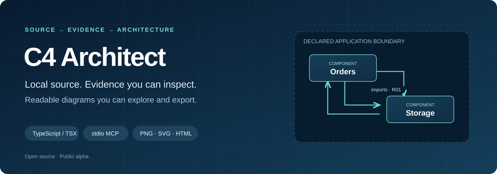
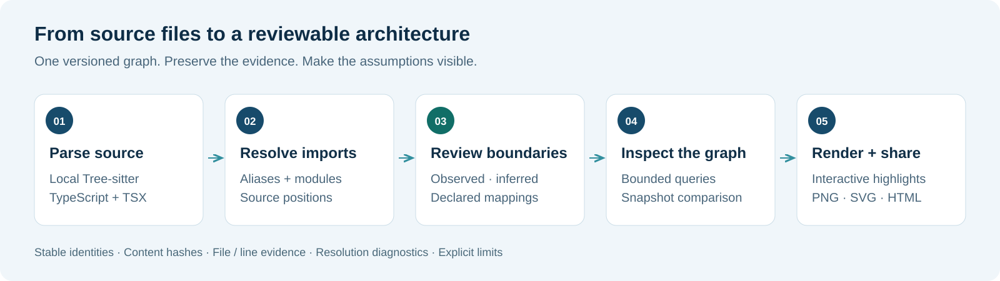
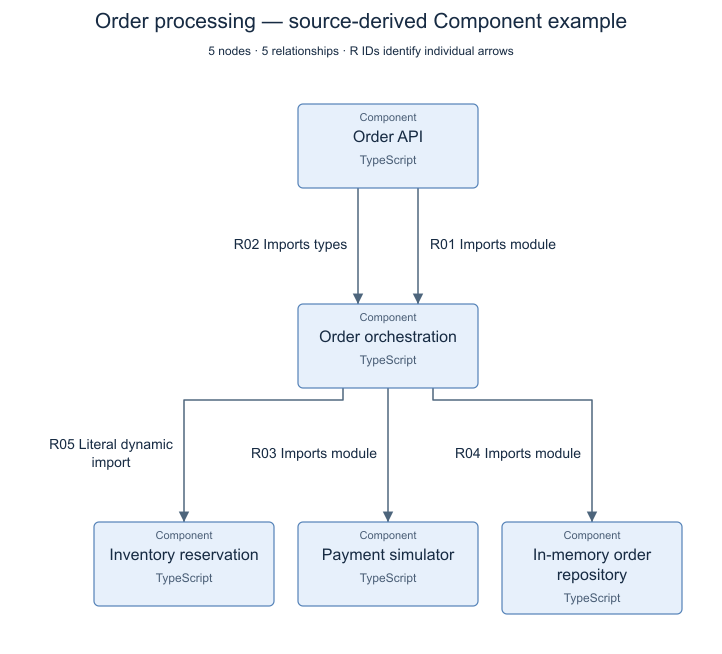
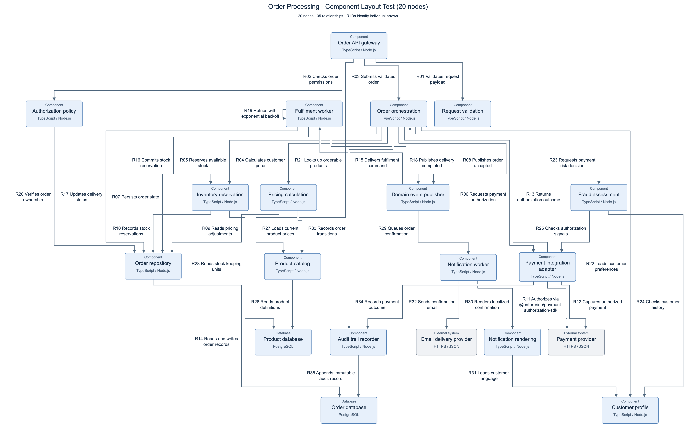
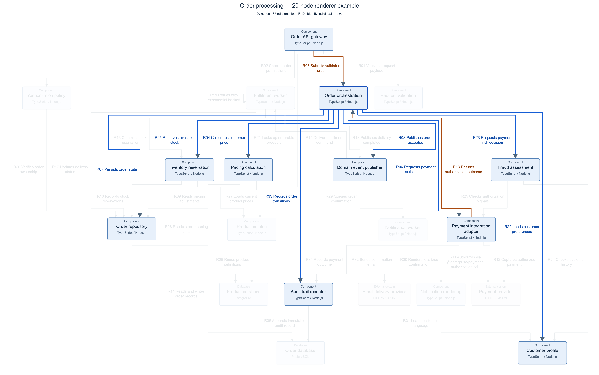

# C4 Architect

**Explore a TypeScript codebase without pasting the whole repository into a prompt.**

C4 Architect is a local [Model Context Protocol](https://modelcontextprotocol.io/) server that turns source imports into a versioned dependency graph, lets you review and name its architectural boundaries, and produces compact C4 diagrams. Use it from Codex, Claude Code, Claude Desktop, or another client that supports local MCP servers over `stdio`.

**0.2.0-alpha.2 · TypeScript / TSX · Local parsing · MIT licensed**

[Get started](#get-started) · [npm package](https://www.npmjs.com/package/c4-architect-mcp) · [See the diagrams](#read-the-diagram) · [Contribute](https://github.com/zrack/c4-architect-mcp/blob/main/CONTRIBUTING.md) · [Roadmap](https://github.com/zrack/c4-architect-mcp/blob/main/ROADMAP.md)



## Start with evidence

An import is evidence of a code dependency. It does not, by itself, prove that two modules are separately deployed services, that an SDK call uses a particular protocol, or that a data flow is secure.

C4 Architect keeps that distinction visible. Source locations and content hashes support observed dependencies. Naming heuristics remain inferences. A separate boundary configuration records the systems, containers, and components that a person has declared. Rescanning the source preserves those declarations.

The result is a starting point for application and solution architecture review. Runtime behavior, organization structure, and enterprise architecture still need other evidence.

| Available in this alpha | Purpose |
| --- | --- |
| Local Tree-sitter analysis | Extract TypeScript and TSX dependencies without an LLM parsing the source files. |
| Versioned graph and source evidence | Save a graph for review, with source locations, file hashes, and analysis diagnostics. |
| Explicit boundary mapping | Give systems, containers, and components stable names through a separate configuration file. |
| Summary, neighborhood queries, and comparison | Inspect a saved graph without returning the entire graph every time. |
| Context, Container, and Component diagrams | Render a graph projection or a graph supplied by the caller. |
| Compact PNG, SVG, and interactive HTML | Trace orthogonal connections, inspect relationship labels, and export a selected view. |

Draw.io, Structurizr DSL, wiki publishing, cross-repository mapping, additional languages, and assisted threat modeling are **planned**, not implemented. See the [roadmap](https://github.com/zrack/c4-architect-mcp/blob/main/ROADMAP.md).

## Get started

Use Node.js 22 or 24 and npm. Run the pinned alpha without a checkout:

```sh
npx -y c4-architect-mcp@0.2.0-alpha.2 --help
```

The examples pin `0.2.0-alpha.2` for a repeatable setup. `c4-architect-mcp@alpha` follows the prerelease channel and currently selects `0.2.0-alpha.2`. npm's `latest` tag remains on `0.2.0-alpha.1`, the initial prerelease. There is no stable release yet.

The server communicates over `stdio`; starting it without a subcommand waits for an MCP client rather than opening a browser page or an HTTP port. The following configurations let your client start it through `npx`.

<details>
<summary><strong>Codex</strong></summary>

Add this to `~/.codex/config.toml`, or use the MCP server settings in the Codex desktop app:

```toml
[mcp_servers.c4-architect]
command = "npx"
args = ["-y", "c4-architect-mcp@0.2.0-alpha.2"]
```

You can also register it from the Codex CLI:

```sh
codex mcp add c4-architect -- npx -y c4-architect-mcp@0.2.0-alpha.2
```

Reconnect the server after configuration changes. See the [official Codex MCP setup guide](https://learn.chatgpt.com/docs/extend/mcp).

</details>

<details>
<summary><strong>Claude Code</strong></summary>

```sh
claude mcp add --transport stdio c4-architect -- npx -y c4-architect-mcp@0.2.0-alpha.2
```

Use `/mcp` to inspect the connection. See the [official Claude Code MCP documentation](https://code.claude.com/docs/en/mcp).

</details>

<details>
<summary><strong>Claude Desktop</strong></summary>

Open **Settings → Developer → Edit Config** and merge this entry with your existing `mcpServers` configuration:

```json
{
  "mcpServers": {
    "c4-architect": {
      "command": "npx",
      "args": ["-y", "c4-architect-mcp@0.2.0-alpha.2"]
    }
  }
}
```

Completely restart Claude Desktop after saving. For Windows JSON paths, use forward slashes or escape each backslash. See the [official local MCP server setup guide](https://modelcontextprotocol.io/docs/develop/connect-local-servers).

</details>

These are local `stdio` configurations. Verify the connection in your chosen client. If a desktop app cannot find `npx`, use the executable's absolute path. On Windows, a client that cannot launch `npx` directly can use `command: "cmd"` with `args: ["/c", "npx", "-y", "c4-architect-mcp@0.2.0-alpha.2"]`.

### Optional global installation

```sh
npm install -g c4-architect-mcp@0.2.0-alpha.2
c4-architect-mcp --help
```

With a global installation, use `c4-architect-mcp` as the MCP command with no arguments, or use it in place of the pinned `npx` command below. Use an absolute executable path if your desktop client's PATH differs from your terminal's.

### Use the CLI directly

You can analyze and render without an MCP client:

```sh
npx -y c4-architect-mcp@0.2.0-alpha.2 analyze /absolute/path/to/project/src --level Component --out /absolute/path/to/project/architecture.graph.json --summary
npx -y c4-architect-mcp@0.2.0-alpha.2 summary /absolute/path/to/project/architecture.graph.json
npx -y c4-architect-mcp@0.2.0-alpha.2 render /absolute/path/to/project/architecture.graph.json --out /absolute/path/to/project/ARCHITECTURE.md
```

Replace `/absolute/path/to/project` with your project's location. Open the generated `ARCHITECTURE.html` beside the Markdown to explore the diagram.

For explicit compiler settings, add `--tsconfig /absolute/path/to/tsconfig.json` to `analyze`. The nearest `tsconfig.json` is otherwise discovered and read as data. Boundary configuration is loaded only when `--config` is supplied. The CLI also provides `query` and `diff` commands; `--help` lists their options.

### Run from a checkout or try the sample

Clone the repository to contribute, inspect the source, or try the included [synthetic order-service example](https://github.com/zrack/c4-architect-mcp/blob/main/examples/README.md):

```sh
git clone https://github.com/zrack/c4-architect-mcp.git
cd c4-architect-mcp
npm ci
npm test
node dist/index.js analyze examples/order-service/src --level Component --config examples/c4-architect.config.json --out output/order-service.graph.json --summary
node dist/index.js render output/order-service.graph.json --out output/ORDER-SERVICE.md
```

`npm test` builds `dist/index.js` and runs the automated tests. Open `output/ORDER-SERVICE.html` to explore the sample. To connect an MCP client to your checkout, use `node` as the command and the absolute path to `dist/index.js` as its only argument. After changing TypeScript, run `npm run build` and reconnect the server to load the new code.

## Analyze a project

Ask your connected client:

> Use c4-architect to analyze `/absolute/path/to/project/src` at the Component level. Save the graph to `/absolute/path/to/project/architecture.graph.json` and return a summary. Review the diagnostics and inferred boundaries, then use `render_architecture_graph` to save `/absolute/path/to/project/ARCHITECTURE.md`.

The analysis tool accepts:

```json
{
  "targetDir": "/absolute/path/to/project/src",
  "c4Level": "Component",
  "outputPath": "/absolute/path/to/project/architecture.graph.json",
  "responseMode": "summary"
}
```

`responseMode: "summary"` saves the complete graph locally and returns counts and status, keeping it out of the model's context until needed. It requires `outputPath`. The default `"graph"` mode returns the graph.

Use absolute paths: an MCP client's working directory may differ from the repository you want to analyze. Check diagnostics before treating a missing edge as an absent dependency. Static analysis cannot resolve every computed import or establish every runtime connection.

The current parser covers `.ts` and `.tsx`, excluding declaration files, dependency/build/output directories, and symlink trees. It uses one nearest or explicitly supplied `tsconfig.json` per scan; nested project configurations are not orchestrated automatically. Static imports, re-exports, and literal `import()` / `require()` dependencies are supported; computed dependencies and parse problems remain visible through diagnostics.

Existing CSS, SVG, and other local assets found through relative imports, `paths` aliases, or `baseUrl` produce an `UNSUPPORTED_MODULE_TYPE` diagnostic. The graph contains the TypeScript/TSX dependencies. An unresolved specifier that matches a configured alias produces an `UNRESOLVED_IMPORT` diagnostic.

To name architectural boundaries, supply `configPath` explicitly. The [example configuration](https://github.com/zrack/c4-architect-mcp/blob/main/examples/c4-architect.config.json) demonstrates the format:

```json
{
  "schemaVersion": "1.0",
  "system": { "id": "shop", "label": "Shop" },
  "defaultContainer": {
    "id": "application",
    "label": "Application",
    "technology": "TypeScript / Node.js"
  },
  "components": [
    { "id": "orders", "label": "Order orchestration", "paths": ["orders"] },
    { "id": "payments", "label": "Payments", "paths": ["payments"] }
  ]
}
```

`paths` are literal file or directory prefixes relative to `targetDir`, not globs. Give a component a `containerId` when mapping it into an explicitly configured container. Ambiguous matches are rejected. Unmapped files use the default container, which is inferred unless you configure it. Keep this configuration separate from the generated graph.

```json
{
  "targetDir": "/absolute/path/to/project/src",
  "c4Level": "Component",
  "configPath": "/absolute/path/to/project/c4-architect.config.json",
  "tsconfigPath": "/absolute/path/to/project/tsconfig.json",
  "outputPath": "/absolute/path/to/project/architecture.graph.json",
  "responseMode": "summary"
}
```

## Inspect before drawing

| Tool | Input | Result |
| --- | --- | --- |
| `analyze_architectural_boundaries` | `targetDir`, `c4Level`; optional `configPath`, `tsconfigPath`, `outputPath`, `responseMode` | A saved graph, full response, or compact summary at the requested C4 level. |
| `get_architecture_summary` | `graphPath` | A compact overview of a saved graph and its diagnostics. |
| `query_architecture_graph` | `graphPath`; optional `nodeId`, `search`, `direction`, `maxDepth`, `maxNodes`, `maxEdges`, `maxBytes`, `includeEvidence` | A bounded neighborhood or search, with truncation reported. |
| `compare_architecture_graphs` | `beforePath`, `afterPath`; optional `limit`, `maxBytes` | Change counts and bounded details for snapshots at the same C4 level. |
| `render_architecture_graph` | `graphPath`; optional `title`, `outputPath`, `focus` | Render a saved graph or a focused neighborhood. |
| `render_c4_mermaid` | `title`, `c4Level`, `nodes`, `relationships`, optional `outputPath` | Mermaid source and a compact server-rendered PNG; saved SVG, PNG, HTML, and Markdown when requested. |

Queries default to `direction: "both"`, `maxDepth: 1`, `maxNodes: 25`, `maxEdges: 50`, and `maxBytes: 16000`. Source evidence is opt-in. Start with a summary, then search for a component or request its incoming or outgoing dependencies. Smaller views are usually easier to review than a complete repository drawing.

Render a saved graph directly:

```json
{
  "graphPath": "/absolute/path/to/project/architecture.graph.json",
  "outputPath": "/absolute/path/to/project/ARCHITECTURE.md"
}
```

For caller-supplied graphs, `render_c4_mermaid` remains available. To adapt an analysis projection manually, preserve its `nodes` and convert its `edges`:

```js
const relationships = analysis.edges.map(edge => ({
  from: edge.source,
  to: edge.target,
  label: edge.label,
  technology: edge.protocol === "unknown" ? undefined : edge.protocol,
}));
```

Analysis levels are `Context`, `Container`, and `Component`; renderer levels are `C4Context`, `C4Container`, and `C4Component`. Do not invent a protocol when the analysis has no evidence for it.

### Focus a diagram on one node

Use `query --search` to find the exact node ID for a focused diagram. These commands use the graph from the checkout example and show the outgoing dependencies of Order orchestration.

```sh
npx -y c4-architect-mcp@0.2.0-alpha.2 query output/order-service.graph.json --search "Order orchestration" --depth 0
npx -y c4-architect-mcp@0.2.0-alpha.2 render output/order-service.graph.json --node component:orders --direction outgoing --out output/ORDER-SERVICE.outgoing.md
```

With `--node`, render defaults to both directions, depth 1, 25 nodes, and 50 relationships. Use `--direction incoming` or `--direction outgoing` to trace one direction. Set `--depth`, `--nodes`, and `--edges` to adjust the view. The diagram caption shows how much of the saved graph is included. The render result reports omitted nodes and relationships and whether a node or relationship limit was reached.

The focused Markdown relationship table and interactive HTML details show up to three source locations per relationship. Use the saved graph for the full evidence.

For MCP, pass `focus` to `render_architecture_graph`. Find the ID with `query_architecture_graph` using `search`.

```json
{
  "graphPath": "/absolute/path/to/project/architecture.graph.json",
  "outputPath": "/absolute/path/to/project/ARCHITECTURE.orders.md",
  "focus": {
    "nodeId": "component:orders",
    "direction": "outgoing",
    "maxDepth": 1,
    "maxNodes": 25,
    "maxEdges": 50
  }
}
```

## Read the diagram



*Five declared components and five source-observed dependencies from the checked-in [order-service example](https://github.com/zrack/c4-architect-mcp/blob/main/examples/README.md). The application is synthetic; the dependencies come from its actual source imports.*

[Full-size PNG](https://raw.githubusercontent.com/zrack/c4-architect-mcp/main/docs/images/component-example.png) · [Scalable SVG](https://raw.githubusercontent.com/zrack/c4-architect-mcp/main/docs/images/component-example.svg)

The server computes the image layout with ELK, compares horizontal and vertical arrangements, and reserves space for the wrapped labels it draws. PNG and SVG rendering do not require a browser at runtime. Mermaid remains a compatible source export; a client's Mermaid layout may differ from the server image.

The saved graph preserves the system/container hierarchy. The current image renderer draws a flat view, with parent-container and inferred-boundary information in node descriptions rather than nested boundary boxes. Inspect those descriptions in the interactive view.

Saving `ARCHITECTURE.md` also writes `ARCHITECTURE.svg`, `ARCHITECTURE.png`, and `ARCHITECTURE.html` beside it. The Markdown shows the PNG, links to the interactive view, includes a relationship table, and retains the Mermaid source in a collapsed section.

<details>
<summary><strong>Explore the larger 20-node renderer example</strong></summary>



This separate stress fixture has 20 nodes and 35 relationships, including branching, cycles, shared dependencies, and long labels. Its connections are authored test data rather than extracted source dependencies.

[Full-size PNG](https://raw.githubusercontent.com/zrack/c4-architect-mcp/main/docs/images/component-20.png) · [Scalable SVG](https://raw.githubusercontent.com/zrack/c4-architect-mcp/main/docs/images/component-20.svg)

</details>



*The 20-node stress fixture with Order orchestration selected, saved through the interactive view's export buttons.*

[Full-size selected PNG](https://raw.githubusercontent.com/zrack/c4-architect-mcp/main/docs/images/selection-example.png) · [Scalable selected SVG](https://raw.githubusercontent.com/zrack/c4-architect-mcp/main/docs/images/selection-example.svg)

Select a component to highlight outgoing connections in blue and incoming connections in brown. Other routes fade. Select a relationship ID to isolate that route and inspect its full label. Zoom, keyboard selection, Escape, and **Show all** help you move between details and the complete picture.


**Export PNG** and **Export SVG** preserve the current selection and connection highlighting across the full diagram, regardless of zoom or scroll position. PNG exports at twice the diagram's natural dimensions; SVG remains scalable. The self-contained HTML works as a local file without contacting the MCP server or an external service.

Automatic layout cannot make every graph readable at every size. Crossings can remain, and a large full-graph image may need zoom. Use selection and bounded graph queries to follow a particular change or dependency.

See [image provenance and regeneration instructions](https://github.com/zrack/c4-architect-mcp/blob/main/docs/images/README.md) to reproduce these examples.

## Local execution and data

The parser reads local source files and does not call an LLM API. Generated diagrams and their interaction code are self-contained. Your MCP client receives the tool results, and its own settings determine whether those results are sent to a model or another service. Review those settings before analyzing private source.

Analysis is static; it does not run the analyzed application's code. Output options write the requested graph and diagram files. See [SECURITY.md](https://github.com/zrack/c4-architect-mcp/blob/main/SECURITY.md) for the security scope and reporting process.

## Develop and verify

From a repository checkout:

```sh
npm ci
npm test
npm run test:package
npm run test:layout
```

The regular tests cover parsing, graph contracts, graph operations, rendering, and MCP behavior. The package check exercises a packed installation. The layout check uses real browser geometry and downloads against synthetic 12-node and 20-node fixtures. It checks labels, routes, arrowheads, compactness, highlighting, keyboard controls, and selection-aware PNG/SVG exports.

The layout check uses installed Google Chrome by default. To use Playwright Chromium:

```sh
npx playwright install chromium
C4_BROWSER_CHANNEL=chromium npm run test:layout
```

For PowerShell, set `$env:C4_BROWSER_CHANNEL = "chromium"` before running the test. Browser reports and generated fixtures are written under `output/playwright/component-scale/`. These checks cover the included cases, not every possible graph topology.

The [CI workflow](https://github.com/zrack/c4-architect-mcp/blob/main/.github/workflows/ci.yml) configures tests on Node.js 22 and 24 across Linux, macOS, and Windows, plus a Chromium layout job. See the [GitHub Actions runs](https://github.com/zrack/c4-architect-mcp/actions) for results.

## Build this with us

Useful contributions start with a concrete case: an import that resolves incorrectly, a boundary that is hard to express, or a diagram whose route is difficult to follow. Small, sanitized fixtures are especially valuable.

- **Report a bug:** include a minimal input, expected result, diagnostics, and a screenshot for rendering problems.
- **Improve analysis:** add source evidence and a regression fixture; keep observed facts separate from inference.
- **Improve diagrams:** test the actual SVG and exported images, including selected views.
- **Design an extension:** discuss its graph contract before adding a new language, renderer, or publisher.
- **Improve documentation:** try the setup on your platform and client, and report the exact versions used.

Read [CONTRIBUTING.md](https://github.com/zrack/c4-architect-mcp/blob/main/CONTRIBUTING.md), the [Code of Conduct](https://github.com/zrack/c4-architect-mcp/blob/main/CODE_OF_CONDUCT.md), and the [roadmap](https://github.com/zrack/c4-architect-mcp/blob/main/ROADMAP.md). Public API details may change during the alpha; preserve a copy of important graph snapshots and boundary configurations.

## License

C4 Architect is available under the [MIT License](https://github.com/zrack/c4-architect-mcp/blob/main/LICENSE). You may use, modify, and redistribute it, including commercially, subject to the license terms. Dependency licenses and attribution requirements remain applicable; see [NOTICE](https://github.com/zrack/c4-architect-mcp/blob/main/NOTICE) and [third-party notices](https://github.com/zrack/c4-architect-mcp/blob/main/THIRD_PARTY_NOTICES.md).
