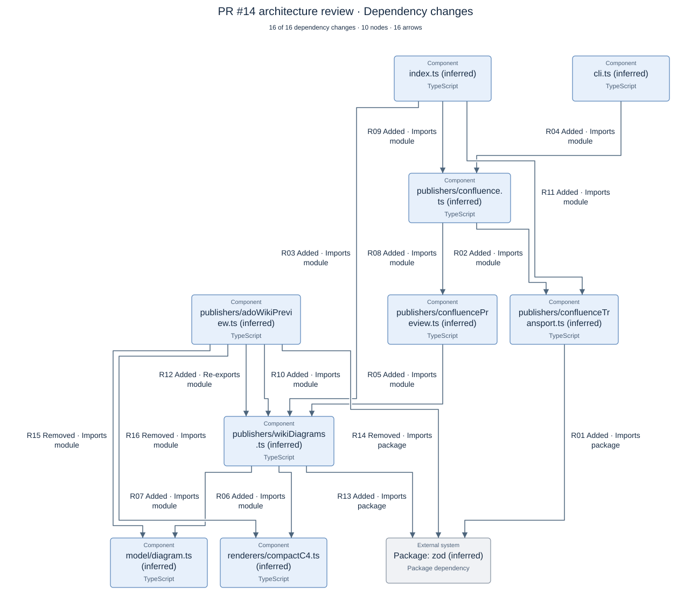
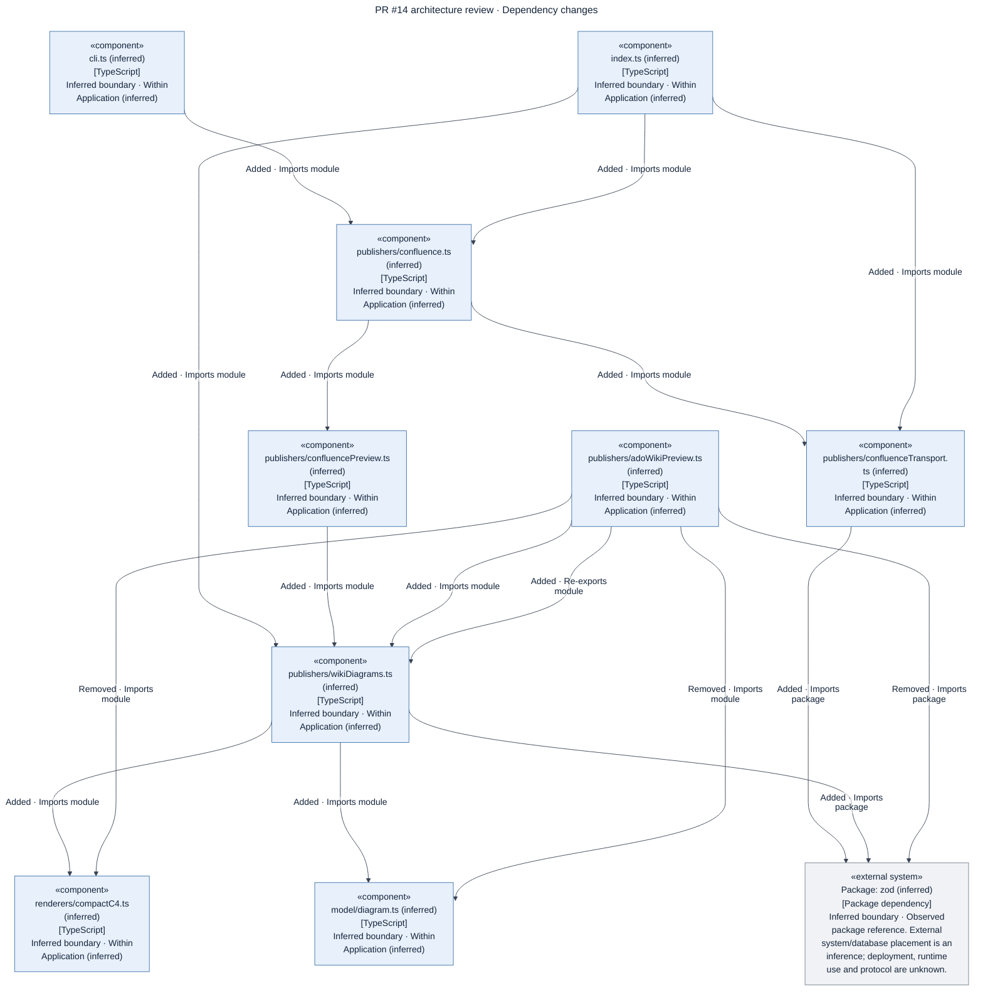

# PR #14 architecture review · Dependency changes

16 of 16 dependency changes · 10 nodes · 16 arrows

[Interactive view](PR-ARCHITECTURE.focus-1cc49cc49dc3856a.html) · [Scalable SVG](PR-ARCHITECTURE.focus-1cc49cc49dc3856a.svg)

Mermaid source export

## Relationships

| ID | From | To | Action | Technology | Source evidence |
|---|---|---|---|---|---|
| R01 | publishers/confluenceTransport.ts (inferred) | Package: zod (inferred) | Added · Imports package |  | publishers/confluenceTransport.ts:1:19 (zod) |
| R02 | publishers/confluence.ts (inferred) | publishers/confluenceTransport.ts (inferred) | Added · Imports module |  | publishers/confluence.ts:3:87 (./confluenceTransport.js) |
| R03 | index.ts (inferred) | publishers/wikiDiagrams.ts (inferred) | Added · Imports module |  | index.ts:18:36 (./publishers/wikiDiagrams.js) |
| R04 | cli.ts (inferred) | publishers/confluence.ts (inferred) | Added · Imports module |  | cli.ts:10:31 (./publishers/confluence.js) |
| R05 | publishers/confluencePreview.ts (inferred) | publishers/wikiDiagrams.ts (inferred) | Added · Imports module |  | publishers/confluencePreview.ts:3:107 (./wikiDiagrams.js) |
| R06 | publishers/wikiDiagrams.ts (inferred) | renderers/compactC4.ts (inferred) | Added · Imports module |  | publishers/wikiDiagrams.ts:6:33 (../renderers/compactC4.js) |
| R07 | publishers/wikiDiagrams.ts (inferred) | model/diagram.ts (inferred) | Added · Imports module |  | publishers/wikiDiagrams.ts:5:31 (../model/diagram.js) |
| R08 | publishers/confluence.ts (inferred) | publishers/confluencePreview.ts (inferred) | Added · Imports module |  | publishers/confluence.ts:2:64 (./confluencePreview.js) |
| R09 | index.ts (inferred) | publishers/confluence.ts (inferred) | Added · Imports module |  | index.ts:16:31 (./publishers/confluence.js) |
| R10 | publishers/adoWikiPreview.ts (inferred) | publishers/wikiDiagrams.ts (inferred) | Added · Imports module |  | publishers/adoWikiPreview.ts:3:121 (./wikiDiagrams.js) |
| R11 | index.ts (inferred) | publishers/confluenceTransport.ts (inferred) | Added · Imports module |  | index.ts:17:40 (./publishers/confluenceTransport.js) |
| R12 | publishers/adoWikiPreview.ts (inferred) | publishers/wikiDiagrams.ts (inferred) | Added · Re-exports module |  | publishers/adoWikiPreview.ts:5:61 (./wikiDiagrams.js) |
| R13 | publishers/wikiDiagrams.ts (inferred) | Package: zod (inferred) | Added · Imports package |  | publishers/wikiDiagrams.ts:4:19 (zod) |
| R14 | publishers/adoWikiPreview.ts (inferred) | Package: zod (inferred) | Removed · Imports package |  | publishers/adoWikiPreview.ts:4:19 (zod) |
| R15 | publishers/adoWikiPreview.ts (inferred) | model/diagram.ts (inferred) | Removed · Imports module |  | publishers/adoWikiPreview.ts:5:31 (../model/diagram.js) |
| R16 | publishers/adoWikiPreview.ts (inferred) | renderers/compactC4.ts (inferred) | Removed · Imports module |  | publishers/adoWikiPreview.ts:6:33 (../renderers/compactC4.js) |
