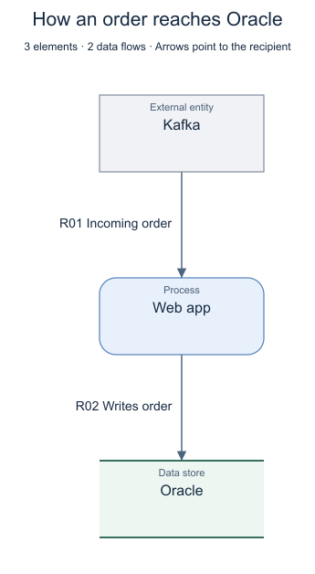
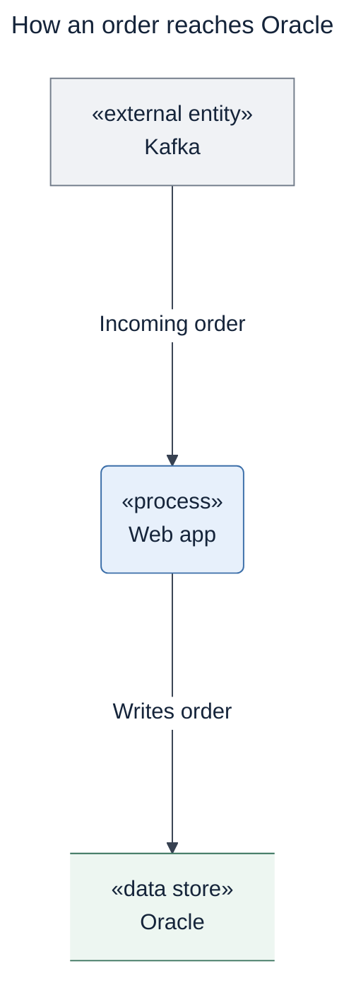

# How an order reaches Oracle

[Interactive view](overview.html) · [Scalable SVG](overview.svg)

Mermaid source export

## Data flows

| ID | From | To | Data carried | Technology |
|---|---|---|---|---|
| R01 | Kafka | Web app | Incoming order |  |
| R02 | Web app | Oracle | Writes order |  |
