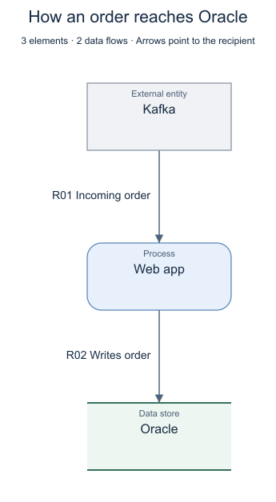

# How an order reaches Oracle

Your web app receives orders originating in Kafka and writes them to Oracle. The first arrow shows where the order comes from. The component that reads the Kafka event is still unknown.

**Which component consumes the order event from Kafka?**

That component owns the Kafka checkpoint, which tells it where to resume after a restart. A receipt acknowledgment confirms delivery to the app. The diagram leaves open what evidence the consumer has of an Oracle commit when it advances the checkpoint.

[Edit the diagram model](overview.json) · [Open the rendered diagram](overview.html)
