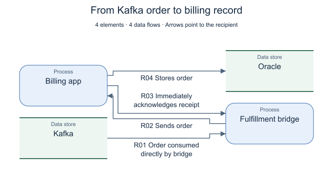
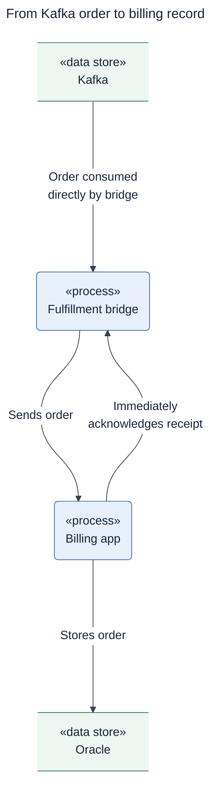

# From Kafka order to billing record

[Interactive view](overview.html) · [Scalable SVG](overview.svg)

Mermaid source export

## Data flows

| ID | From | To | Data carried | Technology |
|---|---|---|---|---|
| R01 | Kafka | Fulfillment bridge | Order consumed directly by bridge |  |
| R02 | Fulfillment bridge | Billing app | Sends order |  |
| R03 | Billing app | Fulfillment bridge | Immediately acknowledges receipt |  |
| R04 | Billing app | Oracle | Stores order |  |
