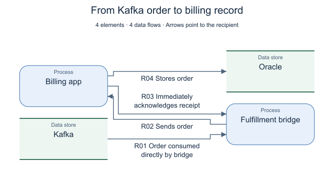

# From Kafka order to billing record

The fulfillment bridge consumes each order directly from Kafka and sends it to the billing app. The app immediately acknowledges receipt to the bridge. The app also stores the order in Oracle.

The receipt tells the bridge that billing received the order. Whether the bridge can tell that Oracle committed it is still open. If the bridge advances its checkpoint on receipt and the write then fails, a restart from that checkpoint can skip the order.

**What evidence does the fulfillment bridge require before it advances its Kafka checkpoint past an order?**

[Edit the diagram model](overview.json)
