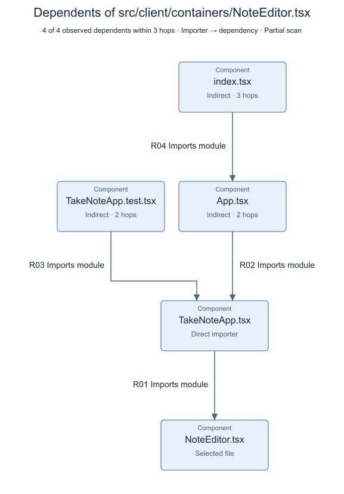

# File-impact regression and architect walkthrough

On November 24, 2026, C4 Architect passed 99 regression tests on each of three platform and Node combinations. In TakeNote, its impact report identified the exact caller that TypeScript rejected when the editor gained a required prop. The tested commit was `a2e277e8f583af6600bf44c63d3a58e22680d262` on `feat/what-depends-on-this-file`.

## What changed during testing

- A valid named re-export with a line break before `from` disappeared from a dependent's path. The parser now uses TypeScript to verify named re-exports when its primary parser disagrees, retaining the original source locations and type-only status. Regression cases include comments, semicolon insertion, import attributes, and malformed neighboring statements.
- In a diagram with 99 direct importers, the arrowheads converged on a single edge and obscured each other. When more than eight **displayed** relationships point to the same file, the impact diagram now gives each relationship a row with its original arrow ID, importer, dependency, and reference kind. The 100-node fixture went from 1,133 × 10,812 pixels to 492 × 5,058. Individual rows are readable at native size. A 100-node report still requires scrolling. Small graphs keep their connected layout, and a standalone diagram identifies a partial scan. [25-node example](fan-in-25.png)
- The original end-to-end test timed out rendering C4 Architect’s own 41-node, 112-relationship diagram. For dense Component diagrams, the renderer now uses a faster node-placement algorithm and still compares both orientations. On the identical input, layout and PNG generation fell from 14.71 to 5.50 seconds in a paired run. Both outputs retained all 112 labeled relationships, with zero node/label box overlaps. The new canvas was taller (4,231 × 3,204 versus 4,270 × 1,871), with 154 orthogonal crossings versus 175. The full view still benefits from zoom.

## Regression and feature coverage

| Check | Result |
| --- | --- |
| Repository suite, macOS 26.6 arm64 | 99 of 99 passed on both Node 22.23.5 and Node 24.22.0. |
| Repository suite, Debian 12 arm64 | 99 of 99 passed on Node 22.23.4. |
| Installable package | All three environments installed the packed artifact with production dependencies and exercised its executable, parser, resolver, renderer, PR review, and file-impact report. Each package contained 93 approved files. |
| Public entry points | All 13 MCP tools over stdio and all 14 CLI commands produced their expected results. The probes read the saved report, image, export, or preview payload. |
| File impact | 11 acceptance groups covered source-linked paths and aliases, cycles, diamonds, depth and size limits, concurrent writes, invalid inputs, and recovery within the same server session. |
| Parser comparison | All 24 named re-export and surrounding-syntax cases agreed with TypeScript on the tested dependency and location. |
| Diagram types | All seven Trail Notes views rendered. The saved Markdown, PNG, SVG, and interactive HTML were checked. All seven PNGs retained the previous bytes after optimizing dense diagrams. |
| Browser and exports | In Chrome, the 20-node diagram contained 35 relationships. Selecting Order orchestration highlighted its 10 connections. The SVG and the full-size 4,444 × 2,786 PNG preserved that selection. |
| Runnable sample | The Trail Notes retry returned the original note ID, left one note in storage, and rejected a changed draft under the same request key. |

Publishing coverage includes local Azure DevOps Wiki, Confluence, and Notion previews plus simulated API success and failure paths in the regression suite. Authenticated writes to hosted services and Windows execution were outside this run. This chat’s configured connector exposed six tools. I used a direct stdio connection to the tested branch for the new file-impact tool. [Feature and regression checks](checks.json)

## Response times

| Workload | Repetitions per mode | Connected MCP median / p95 | Fresh CLI median / p95 | p95 target (MCP / CLI) |
| --- | ---: | ---: | ---: | ---: |
| Trail Notes, 6 files | 10 | 0.06 s / 0.12 s | 0.81 s / 0.87 s | 2.00 s / 4.00 s |
| TakeNote, 76 files | 15 | 0.24 s / 0.26 s | 1.06 s / 1.22 s | 2.00 s / 4.00 s |
| 1,001 files, 25-node limit | 10 | 0.35 s / 2.47 s | 1.02 s / 1.08 s | 8.00 s / 8.00 s |
| 1,001 files, 1,000 multiline re-exports | 5 | 0.60 s / 0.60 s | 1.38 s / 1.54 s | 8.00 s / 8.00 s |
| 1,001 files, 100-node limit | 5 | 0.57 s / 0.61 s | 1.27 s / 1.33 s | Exploratory |

Four simultaneous TakeNote requests on one MCP connection finished at a per-request p95 of **0.90 s** over four batches. The local target was four seconds. Initial server connection took 0.56 s.

Measurements were taken on an eight-core Apple M1 with 16 GiB of RAM, macOS 26.6, and Node 24.22.0 after the regression and browser jobs ended.

The measurements include scanning, layout, writing Markdown and PNG, and returning the result. Each CLI measurement starts a new Node process. The MCP client uses one connection. Each workload gets a first MCP call before timed repetitions. Runs alternate CLI and MCP order, use a warm filesystem, and write to a fresh output path each time. Every sample checks the observed counts, path count, diagram limit, and Markdown-to-PNG reference. Percentiles use nearest rank. At these sample sizes, p95 is the slowest observation. These are local response-time targets.

The large fixture contains 40 direct importers and 960 indirect importers. Its 25-node view shows the selected file and 24 dependents and reports the 976 omitted files. The multiline variant puts all 1,000 re-exports on separate lines before `from`. The 100-node run exercises the largest supported display limit. [Individual measurements](performance.json) · [Runnable benchmark](benchmark.mjs)

To repeat the benchmark, build this checkout with its locked dependencies and supply a clean TakeNote checkout at `e0eddbb9a21ae4cf4c4c7c183f29cfd666e08331`.

```sh
node docs/reviews/file-impact-qa/benchmark.mjs . /path/to/takenote /tmp/c4-performance.json
```

## Architect walkthrough for an editor contract change

**Decision.** A change making `readOnly` a required `NoteEditor` prop needs one observed production caller edit. The import link opens `TakeNoteApp.tsx` at line 11. Line 106 is where the parent actually constructs `<NoteEditor />`. The two `/app` routes and the client entry point tell the architect where to check integration. [Editor declaration](https://github.com/taniarascia/takenote/blob/e0eddbb9a21ae4cf4c4c7c183f29cfd666e08331/src/client/containers/NoteEditor.tsx#L22) · [Import](https://github.com/taniarascia/takenote/blob/e0eddbb9a21ae4cf4c4c7c183f29cfd666e08331/src/client/containers/TakeNoteApp.tsx#L11) · [Edit site](https://github.com/taniarascia/takenote/blob/e0eddbb9a21ae4cf4c4c7c183f29cfd666e08331/src/client/containers/TakeNoteApp.tsx#L106) · [Routes](https://github.com/taniarascia/takenote/blob/e0eddbb9a21ae4cf4c4c7c183f29cfd666e08331/src/client/containers/App.tsx#L62-L67) · [Client mount](https://github.com/taniarascia/takenote/blob/e0eddbb9a21ae4cf4c4c7c183f29cfd666e08331/src/client/index.tsx#L27)

| Scan | Direct | Indirect | What it adds |
| --- | ---: | ---: | --- |
| App source, 1 hop | 1 | 0 | The parent to edit. A depth warning says more importers exist. |
| App source, 3 hops | 1 | 2 | The route and entry point. The scan covered 76 source files and reported 155 warnings or errors. |
| Whole repository, 3 hops | 1 | 3 | A unit test imports the parent. The scan covered 109 source files and reported 232 warnings or errors. |
| Whole repository with locked dependencies installed, 3 hops | 1 | 3 | 9 warnings or errors. The same editor and unit-test paths remain visible. |



I ran the four scans over one MCP connection to the tested server. Every reported path terminates at the editor. I checked every arrow against its import literal and pinned link. [Generated report and source links](NoteEditor.md)

**Check the prediction.** In a disposable copy of the pinned checkout, I used TakeNote’s own TypeScript 4.0.3 compiler. Its application type-check passed, then failed only at `TakeNoteApp.tsx:106` when the editor required `readOnly`. Passing `readOnly={false}` at that site restored a clean check. This experiment verified the caller contract. The unchanged parent’s empty-editor Jest test also passed. [Contract check](contract.json) · [Unit-test assertion](https://github.com/taniarascia/takenote/blob/e0eddbb9a21ae4cf4c4c7c183f29cfd666e08331/tests/unit/client/containers/TakeNoteApp.test.tsx#L91)

The controlled compiler runs used `--noEmit --skipLibCheck`. The unchanged snapshot's unrestricted type-check emitted 33 diagnostics in third-party declaration files. TakeNote also has a Cypress test that types, deletes text, and checks character counts through a browser selector. It has no import path to the editor, so an architect needs to find it separately. The walkthrough verified that test by source inspection only. [Typing test](https://github.com/taniarascia/takenote/blob/e0eddbb9a21ae4cf4c4c7c183f29cfd666e08331/tests/e2e/integration/note.test.ts#L117-L132) · [Editor selector](https://github.com/taniarascia/takenote/blob/e0eddbb9a21ae4cf4c4c7c183f29cfd666e08331/tests/e2e/utils/testNotesHelperUtils.ts#L130)
