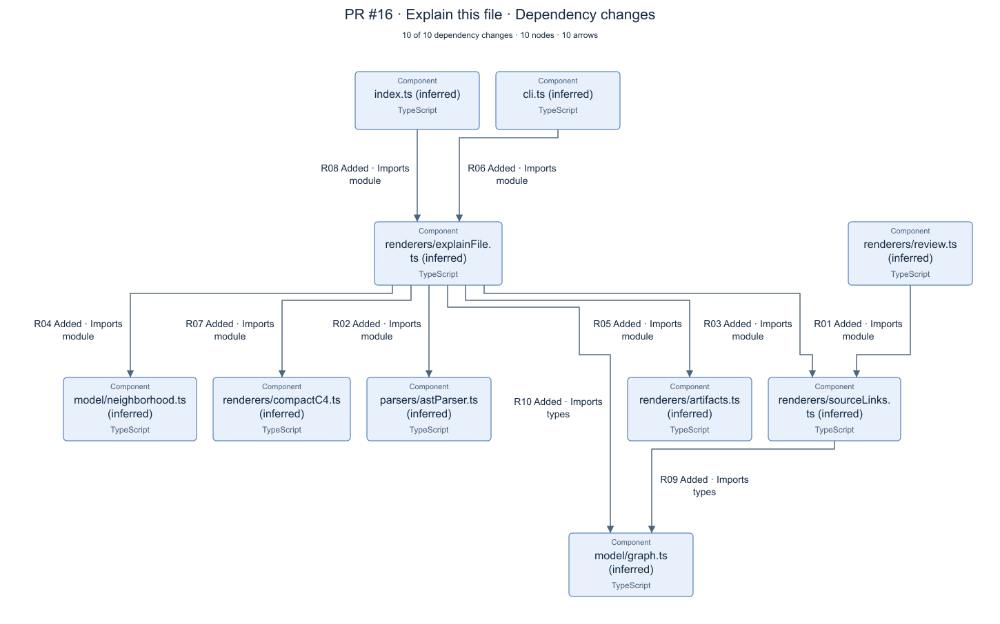
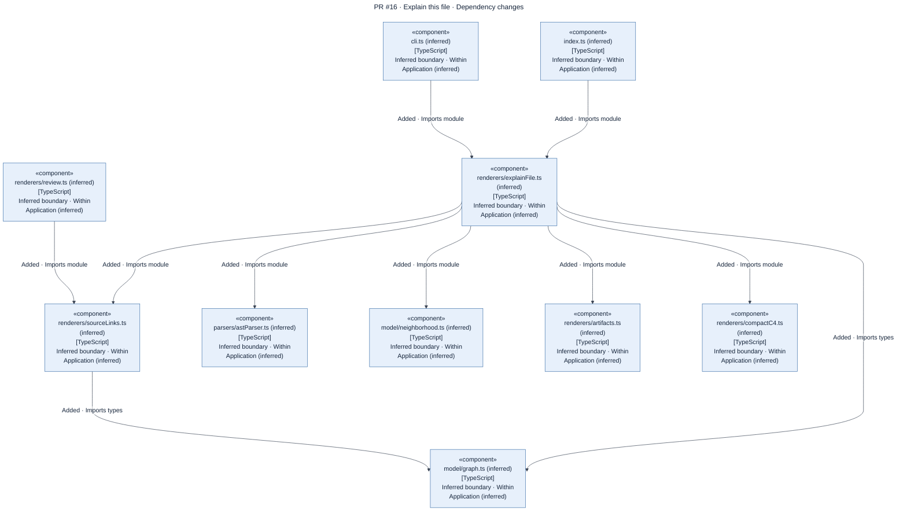

# PR #16 · Explain this file · Dependency changes

10 of 10 dependency changes · 10 nodes · 10 arrows

[Interactive view](PR-16.focus-9032b03b69eb2b17.html) · [Scalable SVG](PR-16.focus-9032b03b69eb2b17.svg)

Mermaid source export

## Relationships

| ID | From | To | Action | Technology | Source evidence |
|---|---|---|---|---|---|
| R01 | renderers/review.ts (inferred) | renderers/sourceLinks.ts (inferred) | Added · Imports module |  | renderers/review.ts:7:115 (./sourceLinks.js) |
| R02 | renderers/explainFile.ts (inferred) | parsers/astParser.ts (inferred) | Added · Imports module |  | renderers/explainFile.ts:7:34 (../parsers/astParser.js) |
| R03 | renderers/explainFile.ts (inferred) | renderers/sourceLinks.ts (inferred) | Added · Imports module |  | renderers/explainFile.ts:10:81 (./sourceLinks.js) |
| R04 | renderers/explainFile.ts (inferred) | model/neighborhood.ts (inferred) | Added · Imports module |  | renderers/explainFile.ts:6:41 (../model/neighborhood.js) |
| R05 | renderers/explainFile.ts (inferred) | renderers/artifacts.ts (inferred) | Added · Imports module |  | renderers/explainFile.ts:8:33 (./artifacts.js) |
| R06 | cli.ts (inferred) | renderers/explainFile.ts (inferred) | Added · Imports module |  | cli.ts:8:29 (./renderers/explainFile.js) |
| R07 | renderers/explainFile.ts (inferred) | renderers/compactC4.ts (inferred) | Added · Imports module |  | renderers/explainFile.ts:9:33 (./compactC4.js) |
| R08 | index.ts (inferred) | renderers/explainFile.ts (inferred) | Added · Imports module |  | index.ts:22:29 (./renderers/explainFile.js) |
| R09 | renderers/sourceLinks.ts (inferred) | model/graph.ts (inferred) | Added · Imports types |  | renderers/sourceLinks.ts:1:38 (../model/graph.js) |
| R10 | renderers/explainFile.ts (inferred) | model/graph.ts (inferred) | Added · Imports types |  | renderers/explainFile.ts:5:58 (../model/graph.js) |
