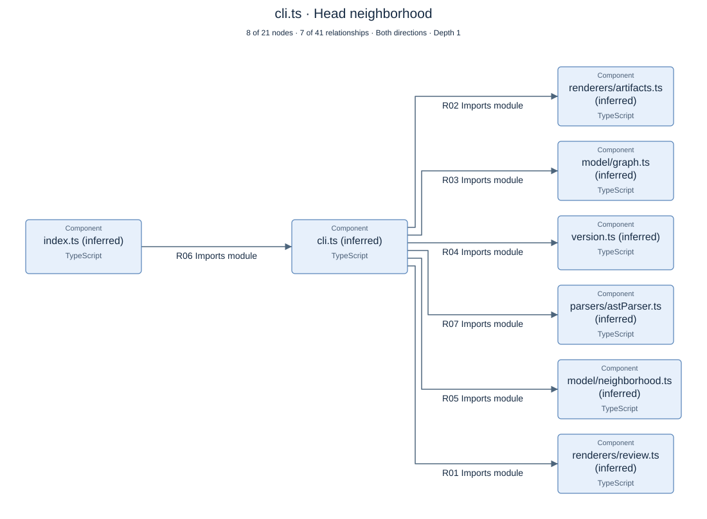
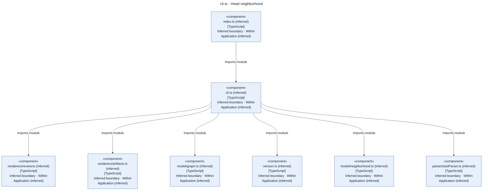

# cli.ts · Head neighborhood

8 of 21 nodes · 7 of 41 relationships · Both directions · Depth 1

[Interactive view](PR-ARCHITECTURE.focus-e758568899e88d5e.html) · [Scalable SVG](PR-ARCHITECTURE.focus-e758568899e88d5e.svg)

Mermaid source export

## Relationships

| ID | From | To | Action | Technology | Source evidence |
|---|---|---|---|---|---|
| R01 | cli.ts (inferred) | renderers/review.ts (inferred) | Imports module |  | cli.ts:7:41 (./renderers/review.js) |
| R02 | cli.ts (inferred) | renderers/artifacts.ts (inferred) | Imports module |  | cli.ts:6:41 (./renderers/artifacts.js) |
| R03 | cli.ts (inferred) | model/graph.ts (inferred) | Imports module |  | cli.ts:4:165 (./model/graph.js) |
| R04 | cli.ts (inferred) | version.ts (inferred) | Imports module |  | cli.ts:8:25 (./version.js) |
| R05 | cli.ts (inferred) | model/neighborhood.ts (inferred) | Imports module |  | cli.ts:5:34 (./model/neighborhood.js) |
| R06 | index.ts (inferred) | cli.ts (inferred) | Imports module |  | index.ts:11:24 (./cli.js) |
| R07 | cli.ts (inferred) | parsers/astParser.ts (inferred) | Imports module |  | cli.ts:3:34 (./parsers/astParser.js) |
