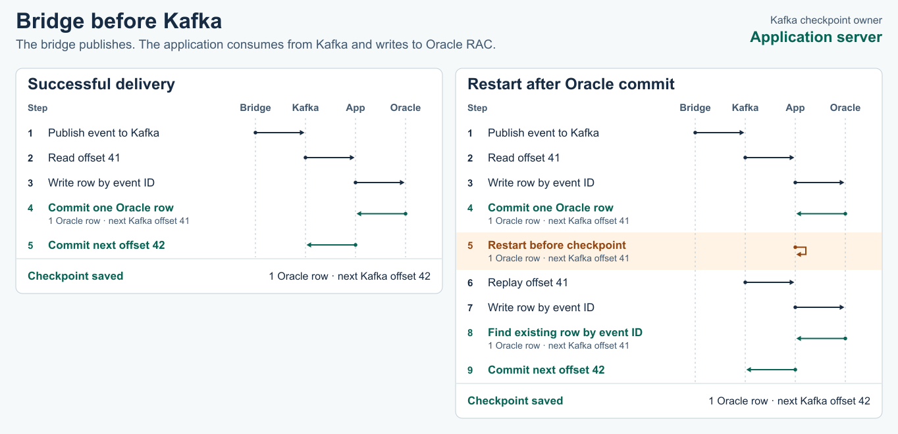
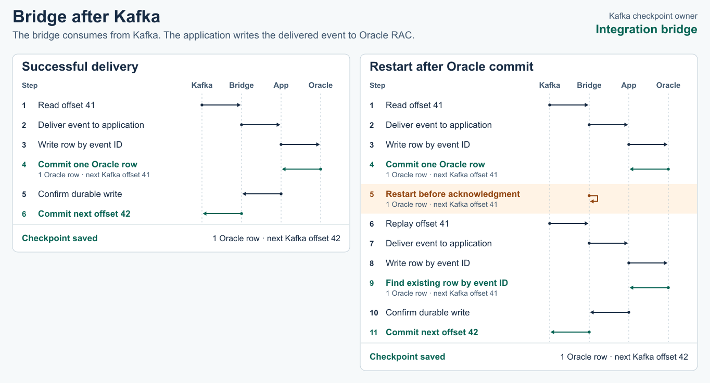

# Kafka and Oracle RAC replay walkthrough

The local simulation delivers event **evt-1042** at Kafka offset **41**. Each case starts with an empty Oracle store and Kafka positioned at that event. The complete business effect is one Oracle row keyed by the event ID. A second delivery of that ID reuses the committed row.

For the downstream bridge, the sample application acknowledges delivery only after it has confirmed the Oracle commit, including a prior commit for the same event ID. The bridge uses that acknowledgment to checkpoint Kafka.

Kafka's next offset is where its consumer will resume. Oracle's row count measures the durable business effect. The [execution traces](traces.json) record both values after every step.

| Placement | Case | Kafka checkpoint owner | At interruption | Final Oracle rows | Final Kafka next offset |
| --- | --- | --- | --- | ---: | ---: |
| Bridge before Kafka | Successful delivery | Application server | — | 1 | 42 |
| Bridge before Kafka | Failed Oracle write | Application server | 0 rows, next offset 41 | 0 | 41 |
| Bridge before Kafka | Restart after commit | Application server | 1 row, next offset 41 | 1 | 42 |
| Bridge after Kafka | Successful delivery | Integration bridge | — | 1 | 42 |
| Bridge after Kafka | Failed Oracle write | Integration bridge | 0 rows, next offset 41 | 0 | 41 |
| Bridge after Kafka | Restart after commit | Integration bridge | 1 row, next offset 41 | 1 | 42 |

## Bridge before Kafka

[Full-size SVG](before-kafka.svg) · [Editable successful delivery diagram](before-kafka-success.json) · [Editable replay diagram](before-kafka-restart-after-commit.json)

## Bridge after Kafka

[Full-size SVG](after-kafka.svg) · [Editable successful delivery diagram](after-kafka-success.json) · [Editable replay diagram](after-kafka-restart-after-commit.json)

The fixture tests one event and its Kafka offset. Production behavior depends on the application's transaction, acknowledgment, and duplicate-handling contracts.
